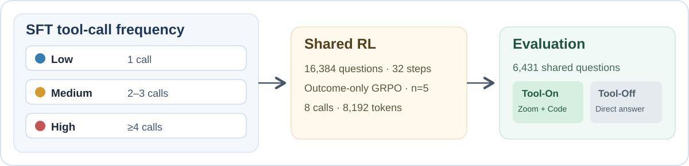

# Tool-Integrated Reasoning (TIR)



## Setup

Clone this repository onto a Linux x86_64 GPU compute node with local storage, Conda, and the CUDA 12.8 toolkit (`nvcc` and headers), then run:

```bash
bash scripts/setup_env.sh
```

This installs Python 3.12 and the pinned packages, downloads Qwen2.5-VL-7B-Instruct, and creates `.tir/{env,cache,models,data,outputs}`. All model and data downloads use fixed public revisions. `.tir/` is ignored by Git; set `TIR_WORK_ROOT` before setup if you prefer another local storage directory.

| Stage | Working allocation per run |
| --- | --- |
| SFT | 2 × H200; 32 CPU cores; 256 GB host RAM |
| RL | 2 × H200; 32 CPU cores; 512 GB host RAM |
| Evaluation | 2 × H200; 32 CPU cores; 512 GB host RAM suggested |

These are working allocations, not measured minimums. Keep model weights, datasets, checkpoints, and caches on compute-node storage.

## SFT

Download and prepare the common source pool once, then train each arm independently:

```bash
bash sft/run.sh prepare
bash sft/run.sh original-low
bash sft/run.sh original-medium
bash sft/run.sh original-high
```

<details>
<summary>SFT controls</summary>

```bash
bash sft/run.sh prepare ablations
bash sft/run.sh prepare filter25-top
bash sft/run.sh filter25-top
bash sft/run.sh prepare filter50-top
bash sft/run.sh filter50-top
bash sft/run.sh prepare filter25-random
bash sft/run.sh filter25-random
bash sft/run.sh prepare filter50-random
bash sft/run.sh filter50-random
```

`no-tool-25` is the Original Medium dataset. Filter 25 and 50 use the frozen 25% and 50% token budgets.

</details>

## RL

Download and reconstruct the exact shared 16,384-question dataset, then pass the SFT checkpoint printed by the training script:

```bash
bash rl/run.sh prepare
bash rl/run.sh /path/to/SFT-checkpoint
```

## Evaluation

Download and prepare the paired 6,431-question suite. Evaluate each SFT or RL checkpoint by passing its path; the script detects its type and runs both Tool-On and Tool-Off:

```bash
bash eval/run.sh prepare
bash eval/run.sh /path/to/checkpoint
```

Preparation verifies frozen question IDs, ordering, images, and answers. Small bundled selection indexes preserve the original SFT/RL data choices; no paid API or new demonstration generation is required. Keep each raw RL checkpoint with its parent run directory so evaluation can read its SFT-model receipt.

To change a training or evaluation setting, edit the labeled settings block in that stage's `run.sh`; the veRL command below it lists the parameters it receives.
